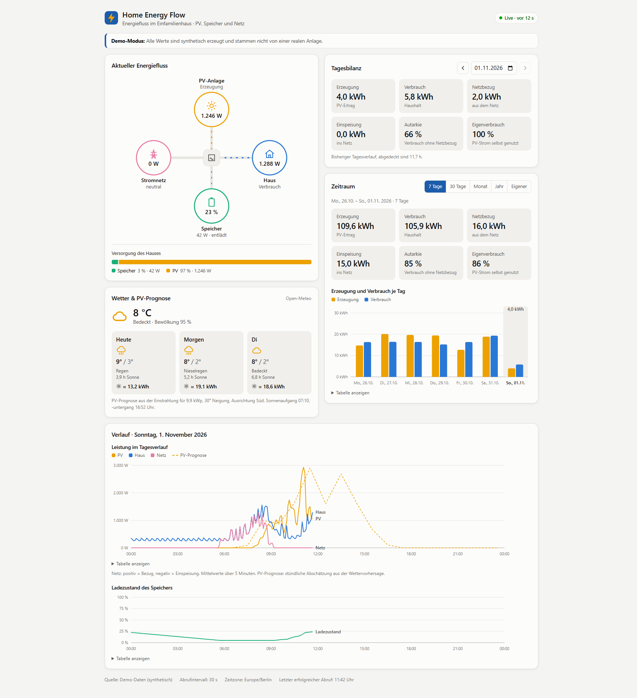

# Home Energy Flow

Energiefluss-Dashboard für ein Einfamilienhaus mit PV-Anlage, Batteriespeicher und Sungrow-Hybridwechselrichter (SH…RT, WiNet-S).
Es zeigt live, wie Strom zwischen PV, Haus, Speicher und Netz fließt, dazu Tagesverlauf, Energiebilanz für frei wählbare Zeiträume sowie Wetter und PV-Prognose.

Ohne eigene Anlage läuft die App im **Demo-Modus** mit synthetischen Daten – zum Ausprobieren braucht es weder Zugangsdaten noch Konfiguration.



## Funktionen

- **Live-Energiefluss**: PV, Haus, Speicher und Netz mit animierter Flussrichtung, dazu die Herkunft des Hausstroms.
- **Datenqualität**: Live/Veraltet/Nicht verfügbar mit Alter des Messwerts. Ein fehlgeschlagener Abruf erscheint nie als „live“.
- **Tagesbilanz und Verlauf**: Erzeugung, Verbrauch, Netzbezug, Einspeisung, Autarkie und Eigenverbrauch; Leistungsverlauf und Ladezustand pro Kalendertag in der Zeitzone der Anlage (inkl. 23-/25-Stunden-Tagen bei der Zeitumstellung).
- **Zeiträume**: 7 Tage, 30 Tage, Monat, Jahr oder eigenes Von–Bis mit Gesamtbilanz; ab zwei Monaten als Monatsbalken.
- **Wetter und PV-Prognose**: Vorhersage für drei Tage von [Open-Meteo](https://open-meteo.com/) (ohne API-Schlüssel), erwarteter PV-Ertrag je Tag und als Vergleichslinie im Tagesverlauf.
- **Lückenlose Historie**: Fehlende Werte (z. B. nach einem Ausfall) werden aus dem Verlauf von iSolarCloud nachgeladen.
- **Zugriffsschutz**: optionales Passwort, wenn die App im Heimnetz erreichbar ist.
- **Barrierearm**: Legende, Direktbeschriftung und Tabellenansicht zu jedem Diagramm, Dark Mode, `prefers-reduced-motion`.

## Technologien

Durchgehend **TypeScript** (strict) als npm-Workspace-Monorepo; Backend und Frontend teilen sich die Typen des API-Vertrags.

| Bereich | Technologie | Wofür |
|---|---|---|
| Laufzeit | [Node.js](https://nodejs.org/) ≥ 20.19 (Docker: 22) | Backend, Build, Tests |
| Backend | [Fastify](https://fastify.dev/) 5 | REST-API, Auslieferung des Frontends (`@fastify/static`), HTTPS |
| | [Zod](https://zod.dev/) 3 | Validierung von Konfiguration, Query-Parametern und externen API-Antworten |
| | [node-postgres](https://node-postgres.com/) (`pg`) 8 | Datenbankzugriff mit eigenen SQL-Migrationen |
| | [selfsigned](https://github.com/jfromaniello/selfsigned) | Selbst signiertes Zertifikat für lokales HTTPS |
| Frontend | [React](https://react.dev/) 19 | Dashboard |
| | [Vite](https://vite.dev/) 8 | Entwicklungsserver mit Proxy zur API, Produktions-Build |
| | SVG und CSS ohne Chart-Bibliothek | Energiefluss, Zeitreihen- und Balkendiagramme, Hell/Dunkel über CSS-Variablen |
| Datenbank | [PostgreSQL](https://www.postgresql.org/) 17 | Dauerhafte Messwerte (optional, sonst Arbeitsspeicher) |
| Externe Dienste | [Sungrow iSolarCloud OpenAPI](https://developer-api.isolarcloud.eu) | Mess- und Verlaufsdaten der Anlage (OAuth 2.0) |
| | [Open-Meteo](https://open-meteo.com/) | Wettervorhersage und Einstrahlung für die PV-Prognose, ohne API-Schlüssel |
| Build | [tsup](https://tsup.egoist.dev/) | Bündelt das Backend |
| | [tsx](https://tsx.is/) | Backend im Entwicklungsmodus mit Neustart bei Änderungen |
| | [concurrently](https://github.com/open-cli-tools/concurrently) | Startet API und Frontend gemeinsam (`npm run dev`) |
| Qualität | [Vitest](https://vitest.dev/) 3 | Unit- und API-Tests |
| | [ESLint](https://eslint.org/) 9 mit [typescript-eslint](https://typescript-eslint.io/) | Statische Analyse inkl. React-Hooks-Regeln |
| Betrieb | [Docker](https://www.docker.com/) und Docker Compose | Mehrstufiges Image (`node:22-alpine`), App mit PostgreSQL |
| | [GitHub Actions](https://github.com/features/actions) | CI: Lint, Typecheck, Tests, Build, Docker-Build |

## Ausprobieren

### Variante 1: Node.js (am schnellsten)

Voraussetzung: Node.js ≥ 20.19.

```bash
git clone <URL dieses Repositorys>
cd home-energy-flow
npm install
npm run dev
```

Dashboard: <http://localhost:5173>. Die API läuft auf Port 3000 und erzeugt beim Start sieben Tage simulierte Historie. Messwerte liegen nur im Arbeitsspeicher und sind nach einem Neustart neu simuliert.

### Variante 2: Docker mit PostgreSQL

Voraussetzung: Docker mit Compose.

```bash
cp .env.example .env
docker compose up --build
```

Dashboard: <http://localhost:3000>. Messwerte werden dauerhaft in PostgreSQL (Volume `db-data`) gespeichert.
Läuft auf dem Rechner bereits eine PostgreSQL auf Port 5432, in `.env` `DB_PORT=5433` setzen.

### Eigene Sungrow-Anlage anbinden

Siehe [Sungrow-Anbindung](#sungrow-anbindung). Kurz: App im Developer Portal anlegen, Zugangsdaten in `.env`, `ENERGY_PROVIDER=sungrow-cloud`, im Dashboard bei iSolarCloud anmelden, Messpunkte mit `npm run sungrow:inspect` prüfen.

## Konfiguration

Alle Einstellungen stehen kommentiert in [`.env.example`](.env.example). Die wichtigsten:

| Variable | Standard | Zweck |
|---|---|---|
| `ENERGY_PROVIDER` | `demo` | `demo` oder `sungrow-cloud` |
| `DATABASE_URL` | – | PostgreSQL; ohne Angabe nur Arbeitsspeicher |
| `RETENTION_DAYS` | `400` | Messwerte älter als so viele Tage werden gelöscht |
| `HOST` / `APP_PASSWORD` | `0.0.0.0` / – | Erreichbarkeit und Zugriffsschutz, siehe unten |
| `HTTPS` | `false` | Selbst signiertes Zertifikat für localhost (für iSolarCloud nötig) |
| `WEATHER_LATITUDE` / `WEATHER_LONGITUDE` | aus der Anlage | Standort für die Wettervorhersage |
| `PV_PEAK_KW`, `PV_TILT_DEG`, `PV_AZIMUTH_DEG` | –, `30`, `0` | Grundlage der PV-Prognose (Ausrichtung: 0 = Süd, −90 = Ost, 90 = West) |

### Zugriffsschutz

Das Backend lauscht standardmäßig im ganzen Netz (`HOST=0.0.0.0`, in Docker nötig). Mit `APP_PASSWORD` fragt der Browser einmal nach einem Passwort (HTTP Basic, Benutzername beliebig); ohne Anmeldung bleibt nur `/api/health` erreichbar. Alternativ beschränkt `HOST=127.0.0.1` den Zugriff auf diesen Rechner. Das Passwort nur zusammen mit `HTTPS=true` verwenden, sonst geht es im Klartext durchs Netz. Ohne Passwort und mit Netzzugriff warnt das Backend beim Start.

## Architektur

```text
Sungrow iSolarCloud API ─┐                                    ┌─ EnergyBackfiller (Lücken aus dem Verlauf)
(später: Modbus TCP)     ├─► EnergyProvider ─► EnergyPoller ─►┤
Demo-Simulator ──────────┘                    (Validierung)   └─► EnergyRepository ─► EnergyService ─► REST API ─► React-Dashboard
                                                                  (PostgreSQL/RAM)    (Flüsse, Bilanz)      ▲
Open-Meteo ─► WeatherService (Vorhersage, PV-Prognose) ─────────────────────────────────────────────────────┘
```

```text
home-energy-flow/
├── apps/
│   ├── api/                 # Fastify REST API, Poller, Provider, Nachladen, Wetter, PostgreSQL
│   └── web/                 # React + Vite Dashboard
├── packages/
│   └── energy-domain/       # Typen, Einheiten, Energiefluss- und Bilanzberechnung, API-Vertrag
├── docs/                    # Screenshot
├── docker-compose.yml
└── .env.example
```

- **`EnergyProvider`** ist die gemeinsame Schnittstelle für alle Datenquellen. Sungrow-Cloud, Demo und später Modbus lassen sich austauschen, ohne API oder Frontend anzufassen.
- **`energy-domain`** ist herstellerunabhängig und hat keine Abhängigkeiten. Backend und Frontend nutzen dieselben Typen für den API-Vertrag.
- **Ohne `DATABASE_URL`** hält das Backend Messwerte im Arbeitsspeicher. Mit Datenbank laufen Migrationen beim Start automatisch. Auswertungen berücksichtigen nur Messwerte der aktiven Quelle; alte Demo-Daten in derselben Datenbank stören also nicht.

### Vorzeichenkonvention

| Größe | Konvention |
|---|---|
| `pvPowerW`, `householdPowerW` | immer ≥ 0 |
| `batteryPowerW` | > 0 Laden, < 0 Entladen |
| `gridPowerW` + `gridDirection` | Betrag ≥ 0 plus `import` / `export` / `idle` (unter 20 W) |

Gemessen werden nur die Leistungen an den vier Knoten. Wer wen versorgt (z. B. „PV → Speicher“), ist eine Modellannahme des Eigenverbrauchsmodus (`computeFlows`). Eine Differenz aus Wandlungsverlusten oder Messungenauigkeit wird als `unbalancedW` ausgewiesen, nicht versteckt.

## Entwicklung

| Befehl | Zweck |
|---|---|
| `npm run dev` | API und Dashboard mit Hot Reload |
| `npm test` | Vitest (Domain-Logik, API, Poller, Nachladen, Wetter, Sungrow-Client) |
| `npm run typecheck` | TypeScript für alle Pakete |
| `npm run lint` | ESLint |
| `npm run build` | Frontend (Vite) und Backend (tsup) bauen |
| `npm run db:migrate` | Migrationen manuell ausführen |
| `npm run sungrow:inspect` | Anlagen, Geräte und Messpunkte der eigenen Sungrow-Anlage anzeigen |

Die CI (GitHub Actions) führt Lint, Typecheck, Tests, Build und einen Docker-Build aus.

## REST-API

| Endpunkt | Beschreibung |
|---|---|
| `GET /api/health` | Lebenszeichen (ohne Anmeldung) |
| `GET /api/meta` | Datenquelle, Zeitzone, Abrufintervall, Demo-Flag, Aufbewahrungsdauer |
| `GET /api/energy/current` | letzter Messwert, Flüsse, Aktualität, Abrufstatus |
| `GET /api/energy/history?date=YYYY-MM-DD&bucketMinutes=5` | gemittelter Tagesverlauf |
| `GET /api/energy/balance?date=YYYY-MM-DD` | Tagesbilanz |
| `GET /api/energy/balance/daily?days=7` | Tagesbilanzen der letzten Tage |
| `GET /api/energy/balance/range?from=YYYY-MM-DD&to=YYYY-MM-DD` | Gesamt- und Tagesbilanzen eines Zeitraums (≤ 366 Tage); stößt das Nachladen fehlender Werte an |
| `GET /api/weather` | Wetter, Vorhersage für drei Tage und PV-Prognose |

## Sungrow-Anbindung

Die Integration nutzt die **offizielle iSolarCloud Developer API** (OAuth 2.0). Lokales Modbus TCP über den WiNet-S ist als nächste Ausbaustufe vorgesehen. Es werden nur Messdaten gelesen, es gibt keine Schreibzugriffe und keine Anlagensteuerung.

### Einrichten

1. **App im Developer Portal deiner Region anlegen** – für Anlagen in Europa unter <https://developer-api.isolarcloud.eu> (Server „Europe“). Jede Region hat eigene Apps und eigene App-IDs; eine App auf dem internationalen Server funktioniert nicht mit einem EU-Konto.
2. Als Redirect URL `https://localhost:3000/auth/callback` eintragen. Die Authorization URL der App muss danach mit `…&redirectUrl=https://localhost:3000/auth/callback` enden.
3. In `.env` eintragen – **alle drei Werte von derselben App**:
   - `SUNGROW_APP_ID`: Zahl hinter `applicationId=` in der Authorization URL
   - `SUNGROW_APP_KEY`: App Key (32 Hex-Zeichen)
   - `SUNGROW_APP_SECRET`: Secret Key

   Alternativ `config.json` im Projektordner mit `{ "appKey", "secretKey", "appId" }`. `.env` und `config.json` sind in `.gitignore`.
4. `HTTPS=true` setzen, weil iSolarCloud nur `https`-Redirects akzeptiert. Das Backend erzeugt ein selbst signiertes Zertifikat für localhost (`.certs/`); die Browserwarnung einmal unter <https://localhost:3000/api/health> bestätigen. Ohne Warnung geht es mit [mkcert](https://github.com/FiloSottile/mkcert) über `TLS_CERT_FILE` und `TLS_KEY_FILE`.
5. `ENERGY_PROVIDER=sungrow-cloud` setzen, `npm run dev` starten und im Dashboard auf **„Bei iSolarCloud anmelden“** klicken. Auf der Freigabeseite unter „Select plant“ die Anlage auswählen, Datenschutzhinweis bestätigen, „Agree to authorize“.
6. `npm run sungrow:inspect` ausführen: Das Skript listet Anlagen, Geräte und Messpunkte und prüft die Zuordnung an der Energiebilanz. Einmal bei Sonne und einmal nachts prüfen, dann in `.env` übernehmen.

Tokens liegen in `.sungrow-token.json` (gitignored) und werden automatisch erneuert. Scheitert die Erneuerung, zeigt das Dashboard wieder den Anmeldehinweis.

### Häufige Fehler

| Meldung | Ursache |
|---|---|
| „Invalid redirect_uri“ auf der Freigabeseite | Für diese App-ID ist auf diesem Server keine (oder eine andere) Redirect URL hinterlegt – oft eine App aus dem falschen Region-Portal |
| „Token-Tausch fehlgeschlagen: Unauthorized“ | App Key oder Secret gehören nicht zur App-ID, oder Key und Secret wurden vertauscht/doppelt eingetragen |
| „kein Zahlenwert („null“)“ für einen Messpunkt | Die Anlage liefert diesen Punkt nicht; mit `sungrow:inspect` passende Punkte suchen, ggf. Gerätepunkte (siehe unten) |
| `er_hour_call_api_times_upper_limit` | Stündliches Abfragelimit der App erreicht; das Nachladen pausiert dann automatisch bis zur nächsten Stunde |

### Messpunkte

Die voreingestellten Messpunkte (`83067` PV, `83106` Last, `83549` Netz, `83252` SOC) sind Kandidaten. Manche Anlagen liefern auf Anlagenebene nur einen Teil der Werte; der Rest kommt von einzelnen Geräten. Gerätepunkte werden mit Gerätetyp-Präfix adressiert, Differenzen mit `-`:

```bash
# Beispiel SH8.0RT mit Batterie
SUNGROW_POINT_PV=83033                  # Anlagenleistung
SUNGROW_POINT_LOAD=83106                # Hausverbrauch
SUNGROW_POINT_GRID=14:13149-13121       # Netzbezug − Einspeisung am Hybrid-Wechselrichter (Typ 14)
SUNGROW_POINT_BATTERY=14:13126-13150    # Laden − Entladen
SUNGROW_POINT_SOC=83252                 # Ladezustand wie in iSolarCloud angezeigt
```

Ohne Batteriepunkt wird die Batterieleistung aus der Bilanz berechnet.

### Technische Details

| Schritt | Aufruf |
|---|---|
| Freigabe | `https://web3.isolarcloud.eu/?state=…#/authorized-app?cloudId=3&applicationId=…&redirectUrl=…` |
| Token | `POST /openapi/apiManage/token` bzw. `/openapi/apiManage/refreshToken` |
| Anlagen | `POST /openapi/platform/queryPowerStationList` |
| Echtzeit | `POST /openapi/platform/getPowerStationRealTimeData`, `/openapi/platform/getDeviceRealTimeData` |
| Geräte | `POST /openapi/platform/getDeviceListByPsId` |
| Verlauf | `POST /openapi/platform/getPowerStationPointMinuteDataList`, `/openapi/platform/getDevicePointMinuteDataList` (5-Minuten-Werte, ≤ 3 h pro Anfrage) |

Jede Anfrage sendet den Secret Key als Header `x-access-key` und den App Key im Body. Pfade und Felder folgen der Open-Source-Bibliothek [pysolarcloud](https://github.com/bugjam/pysolarcloud) (MIT) und sind an echten Antworten des EU-Gateways geprüft (z. B. Fehler als HTTP 200 mit `"status": "401"` im Body).

iSolarCloud aktualisiert etwa alle 5 Minuten, deshalb ist das Abrufintervall standardmäßig 300 s. Als Messzeitpunkt gilt der `device_time` der Geräte (Ortszeit der Anlage, `APP_TIMEZONE`), nicht der Abrufzeitpunkt. Ein unveränderter Stand wird daher nicht doppelt gespeichert.

Lücken füllt das Backend beim Start, nach einer Anmeldung, stündlich für die letzten `HISTORY_BACKFILL_DAYS` Tage und bei Bedarf für den im Dashboard gewählten Zeitraum. Um das stündliche Abfragelimit von Sungrow zu schonen, lädt es höchstens 24 Stunden Verlauf alle 5 Minuten nach, die jüngsten Lücken zuerst.

## Wetter und PV-Prognose

Die Vorhersage kommt von Open-Meteo (kostenlos, ohne Anmeldung) und wird 30 Minuten zwischengespeichert. Der Standort stammt aus `WEATHER_LATITUDE`/`WEATHER_LONGITUDE`, sonst aus den Anlagendaten von iSolarCloud, im Demo-Modus aus der Mitte Deutschlands. Er wird auf zwei Nachkommastellen (~1 km) gerundet übertragen.

Die PV-Prognose ist eine Abschätzung: Einstrahlung auf die geneigte Modulfläche (W/m²) / 1000 × `PV_PEAK_KW` × `PV_PERFORMANCE_RATIO`. Neigung und Ausrichtung sollten zur eigenen Dachfläche passen; bei Verschattung `PV_PERFORMANCE_RATIO` verkleinern.

## Grenzen

- Die Tagesbilanz integriert Leistungswerte per Trapezregel. Lücken über 15 Minuten werden nicht interpoliert, sondern als fehlende Daten markiert.
- Die Sungrow-Cloud liefert Momentwerte im 5-Minuten-Raster. Die iSolarCloud-App zeigt Sekundenwerte; bei wechselnder Bewölkung können beide deutlich voneinander abweichen.
- Die PV-Prognose berücksichtigt weder Temperatur noch Verschattung im Detail.
- Der Demo-Simulator ist plausibel, aber frei erfunden: ~10 kWp, 9,6 kWh Speicher, deterministisches Wetter und Lastprofil. Wetterkarte und Prognose zeigen im Demo-Modus echtes Wetter für die Mitte Deutschlands.

## Lizenz

[MIT](LICENSE)
